# taoxi-pet 🐾

桃汐，住在 [DeepSeek Harness](https://github.com/deepseek-ai/deepseek-harness) 里的桌面宠物。粉色及腰长卷发，半透明白色水母帽（蕾丝、奶黄小耳朵），奶油黄与白色蓬蓬裙，怀里抱着浅蓝色小水母。

作者：李明杰。联系方式：2212013739@qq.com。

代码基于 [dsh-pet](https://github.com/PC2005-cloud/dsh-pet)（Copyright (c) 2026 PC2005-cloud，MIT）。可以商用、修改和再分发，公开使用时必须保留这段署名和仓库里的 `LICENSE`。形象「桃汐」和对应的动画、提示词由李明杰原创。

<p align="center">
  
  
  
</p>

桃汐会待机呼吸、随机动作（打瞌睡、玩魔方、吃火锅……）、左右转向、屏幕漫游、点击 Q 弹、拖拽甩抛反弹、右键菜单点播——一百余个透明动画随时无缝衔接；还能跟随 DSH 会话事件切换工作状态动画、按档位播放余额动画 + 头顶气泡、碎碎念与对话聊天、窗口失焦时弹系统通知。可多开同屏，能脱离浏览器住上**桌面**（透明置顶小窗），也能自己添加**全新宠物种类**（pet pack）。

这不是一个普通插件，而是**完整的三件套项目**：

```
① 提示词（配方）    →  ② 素材生成链（引擎）  →  ③ 插件（成品）
AI 生成动画的配方     源视频 → 透明动画的管线    运行在 DSH 里的宠物
```

任何人 clone 本仓库，都可以**从零生成自己的桌面宠物**——换角色、换动作、换风格，全流程可复现。

---

## 快速开始（安装插件）

两种装法，任选一种：

- **图形化（桌面应用内）**：打开「插件管理」页，在安装框里填 `taoxi-pet`，不用开终端。
- **命令行**：`dsh plugin --profile <profile> add taoxi-pet`，`<profile>` 按你在用的界面填——`dsh web` 填 `web`，桌面应用（Electron 版）填 `desktop`。

**不想装 DSH？** Release 里提供 Windows x64 绿色包 `taoxi-pet-win-x64.zip`，解压后双击 `taoxi-pet.exe` 就能跑——那是独立模式，不依赖 DSH 环境。

装完**重开 DSH**（`dsh web` 用户则重启 `dsh web`）才生效——运行中的进程持有内存里的旧插件。宠物默认落在界面右上角。

前置要求、源码安装、独立模式的用法与打包、Electron 首次下载、装完会看到什么，见 **[INSTALL.md](INSTALL.md)**。

## 插件功能

只做桌宠本身，不碰 DSH 内核；能力就下面这些。

- **100+ 段动画资产**：待机、走动漫游、玩耍、工作、对话等全部表现都由视频动画驱动，按权重首尾相接，也可换成自己的素材。
- **多开与种类**：同时养多只，各自大小与位置；也能自定义宠物种类（pet pack），一类一套动画与素材。
- **三种运行形态**：DSH web 的浏览器 overlay、DSH 桌面应用的透明置顶窗、完全不依赖 DSH 的独立模式。
- **交互与物理**：点击回应、拖拽甩抛、双击弹弓、宠物互撞，同一套物理与 Q 弹挤压手感，参数可调。
- **手机与触屏**：触屏直接拖拽甩抛，与鼠标共用同一套物理与挤压手感；手机浏览器上还能倾斜手机改变重力方向、摇一摇把宠物甩出去、碰撞时震动反馈——三项可在设置页「移动端效果」里分别关闭。传感器只在 HTTPS 或 localhost 下可用（iOS 还需点一次授权），iOS 与桌面端没有振动 API，会自动跳过。
- **碎碎念与对话**：按周期自动说一句，也能随时聊；记忆持久化、可配图、可念出来。
- **语音（说与听）**：对话回复与手动碎碎念会念出来，音色、音量与总开关可配；按住对话窗的话筒说一句，录音转成文字直接填进输入框。
- **余额展示**：内置常见服务商的余额 / 额度查询，按剩余额度分档播动画并弹气泡；也可以登记自己的服务商。
- **工作状态联动**：跟随 DSH 会话状态切档位动画，并在头顶常驻一句话。
- **待办事项**：一句话加可选到期时间，清单挂在宠物头顶；越临近到期提醒越密，由宠物说出来。
- **睡觉**：右键「睡觉」让它睡下，点一下或右键「起来」叫醒；睡着时完全安静——随机动作、碎碎念、余额、待办与工作状态都不打扰，还会按周期说梦话；睡姿可用 `animations.sleep` 配多套（蹲着睡、趴着睡…）。
- **系统通知**：任务完成或需要确认时弹系统通知，点一下回到对应会话。
- **右键菜单**：换动画、开聊、回到原位、打开 DSH / 网站、重载配置。
- **其他**：点击音效、系统托盘与每只宠物的显示位置。

各项能力的详细说明见 **[FEATURES.md](FEATURES.md)**；配置（大小 / 位置 / 多开 / 物理 / 模型 / 人设 / 宠物种类）见 **[CONFIG.md](CONFIG.md)**。

## 🔌 对外接口（供其他插件调用）

桌宠不只自己玩，也**对外开放两条调用通道**，让别的插件或脚本能驱动它、读它的状态。

- **能做什么**：让它说一句指定的话、播一段指定动画、与它对话；读它当前说的话、工作状态、系统通知与余额
- **为什么开放**：桌宠不该只是个摆设——比如一个「女仆」插件巡检验完想说句话，就能让桌宠当它的「实体」开口；也方便任何人基于它做二次开发
- **通道一 · HTTP**：挂在 DSH 自己的 Web 服务上（前缀 `/taoxi-pet-7340`，只监听本机、无鉴权），跨进程、脚本可直接调。动作类接口只回 `{ok}`，数据统一从 `GET /state` 读
- **通道二 · Cordis 服务**：客户端半侧在 DSH web 页面内注册，同页客户端插件用 `ctx.get('petApi7340')` 直接取，零网络、零端口；只在该页面实例内有效，方法与返回见 [`CORDIS.md`](CORDIS.md)

相关文件（HTTP 与 Cordis 各一套）：

- [`API.md`](API.md) —— HTTP 接口一览（每个接口一句话，功能预览）
- [`openapi.yaml`](openapi.yaml) —— 完整契约（OpenAPI 3.1，可直接导入 Swagger UI / Postman）
- [`CORDIS-API.md`](CORDIS-API.md) —— Cordis 服务一览（每个成员一句话，功能预览）
- [`CORDIS.md`](CORDIS.md) —— 对外 Cordis 服务（客户端半侧，页面内 `ctx.get('petApi7340')`，不走网络）
- [`tools/api-tester.html`](tools/api-tester.html) —— HTTP 侧示例：桌宠控制台，扮演第三方消费方，可直观试用（`node tools/api-tester.cjs` 启动）
- [`tools/cordis-probe`](tools/cordis-probe/README.md) —— Cordis 侧示例：扮演同页客户端插件，用 `ctx.get()` 消费服务

## 兼容性

- **操作系统**：Windows / Linux / macOS 三端均可运行——浏览器 overlay 与桌面模式（Electron 透明置顶窗）行为完全一致；Electron 按平台自动探测/下载（`electron.exe` / `Electron.app` / linux 单文件），无需手动安装
- **无头 / 无桌面环境**：支持 Linux headless 等无图形会话——桌面模式自动检测显示环境（Linux 无 `DISPLAY` / `WAYLAND_DISPLAY` 时判定无显示、跳过桌面窗口，仅日志告警），浏览器 overlay 不受影响
- **浏览器**：浏览器 overlay 兼容 **Chromium 内核（Chrome / Edge 等）与 Firefox**——透明动画依赖 VP9-Alpha webm，三者均已实测透明确认；**不支持 Safari**（macOS 不认 webm alpha，透明渲染为黑底）——macOS 用 `.mov` 素材（GitHub Release `assets-mov`），下载放入即可（见「②.5 Safari/HEVC 兼容素材」）
- **多显示器**：支持多屏环境——跨屏漫游/抛掷以各屏工作区为界，异构缩放（各屏 DPI 不同）、任务栏条带、屏幕之间空洞均正确判定（横屏 / 竖屏 / 上下叠放皆可）；设置页「锁定在当前屏幕」可让宠物（抛掷与漫游）只在当前所在那块屏内活动

## 运行效果

桃汐的动作效果。下面这 8 张是常用动作的预览，完整清单在下一节：

<p>
  
  
  
  
  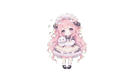
  
  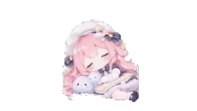
  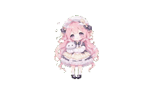
</p>

## 效果预览

全部动画的 GIF 预览在 `taoxi-pet/assets/preview/`，文件名与 `taoxi-pet/assets/webm/` 里的透明视频一致：

**待机 / 转向**

<p>
  
  
</p>

**移动**

<p>
  
  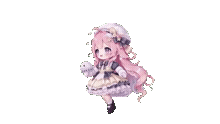
  
  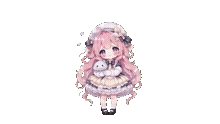
  
</p>

**小动作**

<p>
  
  
  
  
  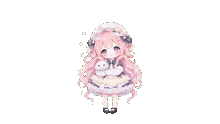
  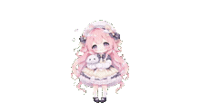
  
  
  
  
  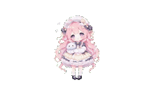
  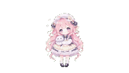
  
  
  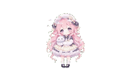
  
  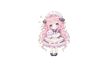
  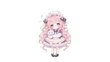
  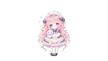
  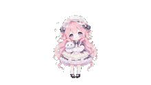
  
  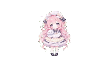
  
  
  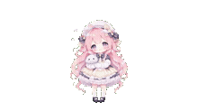
  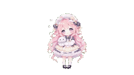
  
  
  
  
  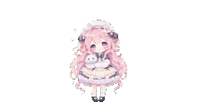
  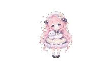
  
  
  
  
  
  
  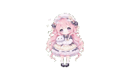
  
  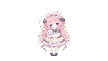
</p>

**玩耍**

<p>
  
  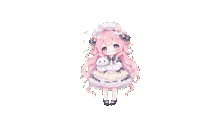
  
  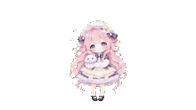
  
  
  
  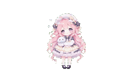
  
  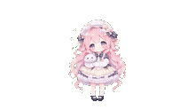
  
  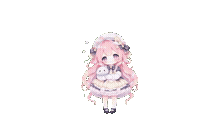
  
  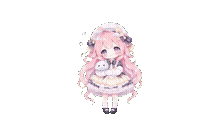
  
  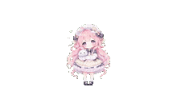
  
  
  
  
  
  
  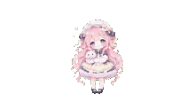
  
  
  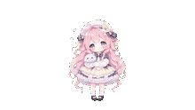
  
</p>

**吃什么**

<p>
  
  
  
  
  
  
  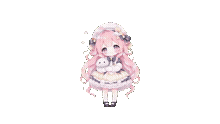
  
  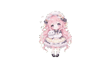
  
  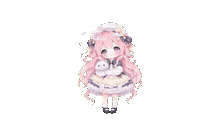
  
  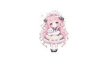
</p>

**时节**

<p>
  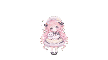
  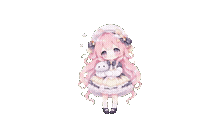
  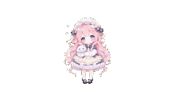
  
  
  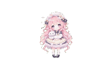
  
  
  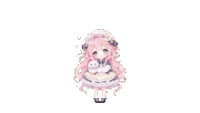
  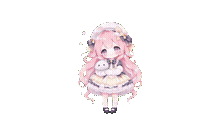
  
  
  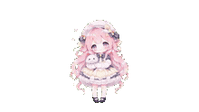
  
  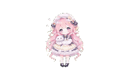
  
  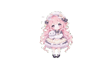
  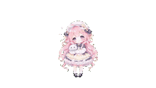
  
  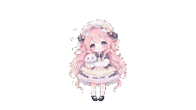
  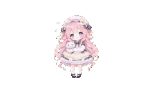
</p>

**文字**

<p>
  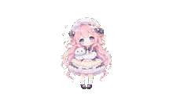
  
</p>

**点击回应**

<p>
  
  
  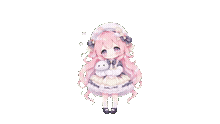
  
  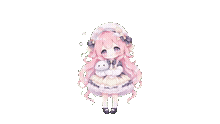
  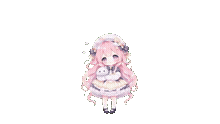
</p>

**拖拽**

<p>
  
</p>

**余额事件**（按余额已用百分比分档，满格 → 告急 → 耗尽）

<p>
  
  
  
  
  
  
</p>

**碎碎念说话动画**（碎碎念 / 对话回复触发，随机抽 1 段）

<p>
  
  
  
  
  
</p>

**工作状态动画**（跟随 DSH 会话事件）

<p>
  
  
  
  
  
  
  
  
  
</p>

**睡觉**（右键「睡觉」或鼠标停上去按 `S`；睡着时点一下叫醒）

<p>
  
  
  
</p>

> 注：动画为透明背景；GIF 预览中透明部分显示为页面底色，实际 webm 播放为透明。

## 从零生成你自己的宠物

AI 提示词 → 绿幕视频 → 透明动画 → 插件，换角色、换动作、换风格，全流程可复现。

完整步骤见 **[MAKE-YOUR-OWN-PET.md](MAKE-YOUR-OWN-PET.md)**（提示词配方、素材链、Safari 兼容、发布）。

## 项目结构

只列代码与发布相关目录；素材链的 video / scripts / step / pr 见 [MAKE-YOUR-OWN-PET.md](MAKE-YOUR-OWN-PET.md) 的 ② 章节（gitignore 的本地目录不列）：

```
├── README.md  INSTALL.md  FEATURES.md  MAKE-YOUR-OWN-PET.md  CONFIG.md  API.md  CORDIS.md  openapi.yaml   # 说明 / 安装 / 功能详解 / 宠物制作指南 / 配置 / HTTP 接口 / Cordis 服务 / OpenAPI 规范
├── prompts/           # ① 动画生成提示词（141 段按动画拆开，见 prompts/README.md）
├── assets/            # 仓库展示用截图
├── tools/             # 开发工具：API 调试页、cordis-probe mock 服务商、DPI 探针
├── .github/workflows/ # CI：Safari/HEVC 转码流水线（macOS runner，手动触发 → 发布 assets-mov Release）
├── taoxi-pet/           # ③ 插件（可独立 npm 发布）
│   ├── src/
│   │   ├── host/       # 宿主半侧：配置 / 路由 / 余额 / 工作状态
│   │   ├── client/     # 浏览器半侧：宠物渲染 / 动画链 / 设置页
│   │   ├── shared/     # 双端共用纯逻辑（物理 / 菜单 / 取数）
│   │   └── standalone/ # 独立模式 CLI（不依赖 DSH 直接跑桌宠）
│   ├── lib/            # 构建产物（npm run build 生成，不入库）
│   ├── runtime/        # 桌面模式运行壳（Electron 透明窗）
│   ├── assets/         # webm 动画 / preview GIF / 字体 / 图标 / config.jsonc 默认配置
│   └── scripts/        # 构建、发布与开发脚本
└── LICENSE             # MIT
```

## 相关项目

- **[aipets](https://github.com/kallen-noelle/aipets)** —— Windows 11 桌面宠物，五个角色可多开，透明置顶、点击穿透、甩动带惯性。特色在**动作由大模型决定**：每轮对话后模型结合时间、天气、电量与好感度挑动作，无人说话时还能排出接近一整天的编排，模型不可用时回退内置规则。聊天接任意 OpenAI 兼容接口，带长期记忆、贴纸、画图与工具调用（联网搜索 / Home Assistant / MCP），支持语音朗读与语音输入；同一套代码既有单文件 `aipets.exe` 桌面版，也有浏览器里的整页舞台版。

## 💬 反馈与发版节奏

问题记在本仓库。这个插件专注桌宠与 DSH 本身。代码问题如果来自上游，也可以对照 [dsh-pet 的提交记录](https://github.com/PC2005-cloud/dsh-pet/commits/main)。

- **小修不单独发版**：不影响使用的小 bug 与优化会**累计**到下一个版本一起发，避免版本更迭过于频繁。所以「`main` 上已经修了」不等于「你装的这版已经包含」——`latest` 没更新时，以 `main` 的提交记录为准。
- **想立刻用上未发布的修复**：按 [INSTALL.md](INSTALL.md) 的「从源码安装」把插件指向本地仓库即可；注意**宿主半侧**的代码改动要**重开 DSH** 才生效（浏览器半侧刷新页面即可）。
- **报 bug 时请带上**：插件版本、`dsh` 版本、操作系统、复现步骤（有日志或截图更好）。

## 许可

- **作者**：李明杰。联系方式：2212013739@qq.com。
- **代码**：MIT，版权属于上游 [dsh-pet](https://github.com/PC2005-cloud/dsh-pet)（Copyright (c) 2026 PC2005-cloud）。可以商用、修改、再分发；副本和实质性部分必须带上 `LICENSE` 里的版权声明和许可全文，公开说明里写上上游仓库地址。
- **形象与动画**：桌宠「桃汐」（粉色长发、半透明白色水母帽、灰藏青蝴蝶结、奶油黄白蓬蓬裙、怀里的浅蓝色小水母）以及本仓库的提示词、透明动画，由李明杰原创。可以商用、修改、再分发；副本和实质性部分必须带上 `LICENSE` 里的版权声明和许可全文，公开说明里写上上游仓库地址。
- **再分发**：基于本仓库的公开衍生作品，除了保留上游代码署名，也要注明形象是桃汐。可以商用、修改、再分发；副本和实质性部分必须带上 `LICENSE` 里的版权声明和许可全文，公开说明里写上上游仓库地址。
